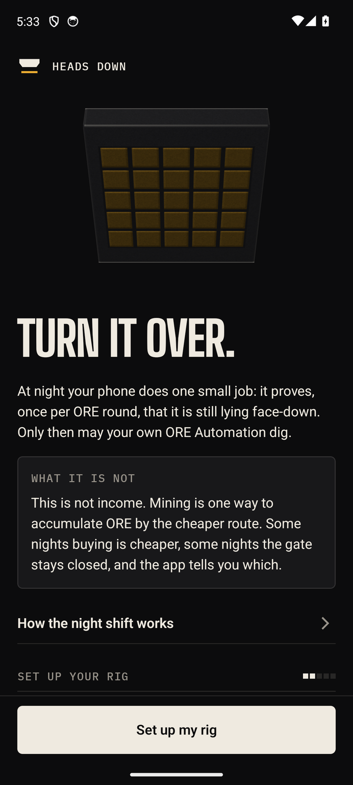
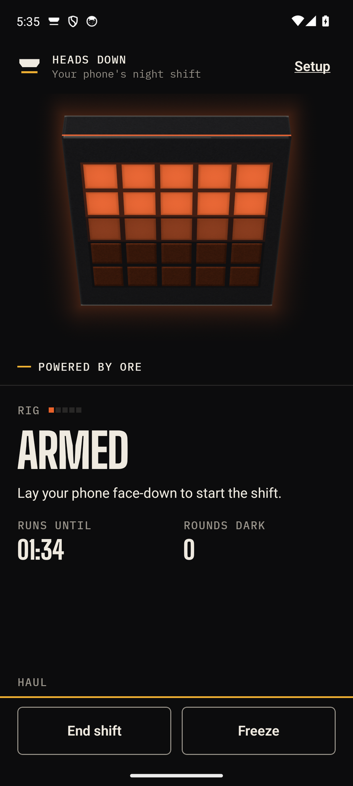
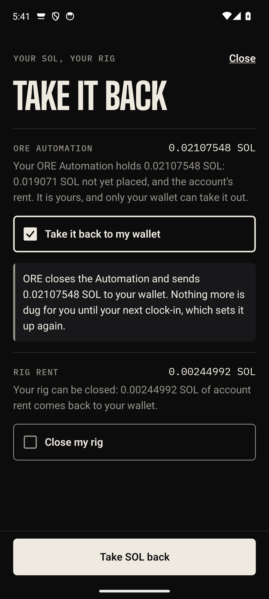
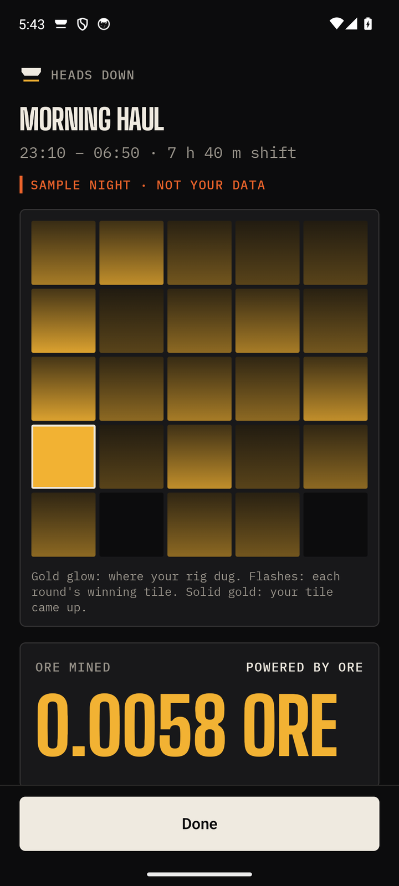

# Heads Down: your phone's night shift, powered by ORE

> Clock in, lay your phone face-down, and it can mine [ORE](https://ore.com). Pick it up and the rig goes cold.
> A dig needs a heartbeat signed by a key in your phone's Android Keystore, verified on-chain. Our servers cannot forge one.

An entry for [Clock In](https://solanamobile.radiant.nexus/), the third Solana Mobile hackathon.
Native Android (Kotlin, Compose), built on the Solana Mobile Stack and Mobile Wallet Adapter. Runs on
any Android 12+ phone with a Solana wallet.

| | |
|---|---|
| **APK** | [Releases](https://github.com/OoJae/heads-down/releases): the newest build is the one to install. Debug-signed, Solana mainnet. Read its notes on what it does with real SOL |
| **Video** | [The demo film on YouTube](https://youtu.be/aGNVRRyyKRU): 2 minutes 12 seconds, with captions. Every phone screen in it is a recording of the Redmi 14C on mainnet, 12 October 2026 |
| **Deck** | 10 slides: [Google Slides](https://docs.google.com/presentation/d/1bTk59mBl9nWac-YoC9V7C9ByD4q1wU_swj2RAZ6IegY/edit?usp=sharing), [PDF](site/deck/heads-down-deck.pdf), [in the browser](https://oojae.github.io/heads-down/deck/) |
| **See it working, no install** | [The founder's rig: every shift, from chain data](https://dashboard-production-b80c.up.railway.app/haul/?rig=DUmg1GrZhaELtpjY1KpA5ov6ANn4msoUPn4mLV2TWZgL) · [the dashboard](https://dashboard-production-b80c.up.railway.app/) |
| **Every transaction it has made** | [docs/MAINNET.md](docs/MAINNET.md) |

## Try it

**Five minutes, no wallet, no SOL.** Install the APK and open it. Turn the slab over with your thumb,
walk through setup (the rig key is made inside the phone; no wallet is asked for), then on the home
screen tap "Open the morning reveal" and "See a sample night (not your data)". That is the page a
shift ends on, with a labelled sample in place of your own night.

**A real shift: 35 minutes, a wallet and about 0.02 SOL.** Use a real phone with a locked
bootloader: the registrar vouches for a rig key on the phone's own key attestation, from its
secure hardware. It has vouched for one phone so far, the founder's, so a second phone's first
clock-in has not been tried.

1. Install a Solana wallet that speaks Mobile Wallet Adapter. The app has been run with Jupiter
   Mobile only.
2. In the Clock app, set an alarm at least 35 minutes ahead (on Xiaomi's HyperOS, at least 50:
   its Clock registers reminders as alarms). Check the home screen's line "runs until HH:MM,
   two minutes before your alarm" before you clock in.
3. Plug the phone in, tap Clock in, confirm in the wallet within 90 seconds, and lay the phone
   face-down.
4. After the window's end, clock out on the page that opens, or from the home screen if your
   phone's system has closed the app. The reveal follows.
5. "Take it back" returns the SOL that was not placed.

A first clock-in moves about 0.014 SOL: the shift's budget of 0.005 SOL (placed in digs, or taken
back) and one-time account rents. Part of the rents comes back when the rig is closed, the shift
log's rent comes back after 30 days, and for the ORE Miner's rent it is not known. Each amount is in
the table "Does it come back?" in [docs/MAINNET.md](docs/MAINNET.md).

**What it has and has not run on.** One phone, the founder's Redmi 14C (Android 16, HyperOS 3), on
mainnet since 10 October 2026, and an Android 14 emulator against a local fork of mainnet. It has
not run on a Seeker. The program can verify a Seeker Genesis Token (tested on a fork with real
tokens); the app has no screen for that yet, so every rig is a guest rig today.

<p>
  
  
  
  
</p>

The app on an Android 14 emulator against a local fork of mainnet, 11 October 2026; the last
screen is the sample night the app offers before a first haul.

## How it works

You clock in with **one wallet approval**. It funds a capped shift inside **your own ORE Automation
account** and arms your rig. While the phone lies face-down it signs a heartbeat for every ORE
round (about a minute) with a P-256 key that never leaves the Android Keystore. Anyone may
submit a dig for your rig, but the `heads_down` program signs ORE's `deploy` **only** when that
heartbeat verifies on-chain, in the same transaction, through Solana's secp256r1 precompile. Pick
the phone up and the next dig is refused with `StaleHeartbeat`. If the phone dies or the app is
killed, nothing is mined and nothing is spent.

Your SOL never sits in a Heads Down account: it stays in ORE's own Automation and Miner accounts,
which only your wallet can withdraw from or claim.

The program digs only when ORE's own production cost is under the ceiling your wallet signed.
A backtest over 58,801 real ORE rounds showed that mining every round costs more than buying ORE;
mining only when that gate opens came out 1.4 to 3.0% cheaper than buying
([ml/forecaster/RESULTS.md](ml/forecaster/RESULTS.md)). That is a modest edge and we say so.

## SKR

SKR is collateral and a gift currency here. It is never locked to be paid for holding it.

- **Focus Bond:** lock SKR on tonight's shift from the app's home screen. Finish the shift and the
  same SKR comes back. Break it and the SKR goes to the Bury auction.
- **Stack:** a table of players bond SKR on keeping their phones down for a window of ORE rounds.
  Finishers share 80% of what the others forfeited; 20% goes to the Bury auction.
- **Gift a Rig:** SOL escrowed for a wallet, or for whoever holds a given Seeker Genesis Token.
- **Bury auction:** forfeited SKR is sold for ORE in a descending-price auction with no oracle, and
  that ORE goes straight through ORE's own `bury` instruction.

All four are in the program and tested ([docs/SKR.md](docs/SKR.md)). In the app, the Focus Bond is
built; the Stack and Gift screens are not yet.

## What is built

| Part | State |
|---|---|
| [`programs/heads-down`](programs/heads-down/README.md) | The on-chain program (Pinocchio, `no_std`). 32 instructions. 171 tests, 138 of them on a fork of live mainnet ORE with the real secp256r1 precompile. Contract: [INTERFACE.md](programs/heads-down/INTERFACE.md) v1.3 with machine-checked golden vectors. Deployed on mainnet on 10 October 2026 |
| [`crates/sgt-verify`](crates/sgt-verify/README.md) | In-program Seeker Genesis Token verifier, tested on real mainnet SGTs and on a forgery that passes weaker checks |
| [`crates/p256-introspect`](crates/p256-introspect/README.md) | secp256r1 precompile introspection and Android Keystore signature helpers |
| [`crank`](crank/README.md) | The permissionless crank: takes the phones' heartbeats, lands digs, BREAK and FREEZE, Stack check-ins. 214 tests, plus 14 against the real program on the fork and one end to end on a local validator. Running on Railway against mainnet since 10 October 2026 |
| [`registrar`](registrar/README.md) | Verifies Android Key Attestation chains and issues the voucher the program checks. 116 tests, 19 of them on real attestation chains. Running on Railway against mainnet |
| [`services/indexer`](services/indexer/README.md) | Chain data into Postgres, a public read API, the morning haul. 477 tests. Running on Railway against mainnet |
| [`dashboard`](dashboard/README.md) | Public numbers, each one recomputable from the chain. [Running on Railway](https://dashboard-production-b80c.up.railway.app) on the indexer's mainnet data |
| [`android`](android/README.md) | The app: Kotlin and Compose, Quick Settings tile, foreground shift service, accelerometer-only face-down detection (no gyroscope needed), Keystore rig key, morning reveal, clock-out, taking SOL back and closing the rig, widget, all drawn from one design module (`core/design`) around a shader-drawn slab that stays level with the real world. a record of every night. 1,440 JVM unit tests. Eight shifts on one physical phone, on mainnet, from 10 to 12 October 2026, one of them three hours through a night; clock-outs and SOL taken back there, to the lamport |
| [`ml`](ml/foreman/README.md) | The on-device models: a pickup-or-bump classifier and a shift planner (trained on synthetic data so far), and a cost forecaster that lost to the simple on-chain rule and only advises |

**Deployed on mainnet on 10 October 2026.** The program is at
[`HDn4vgLWFLLdexKEwfZwRHjWtizNvdqFteLbMsE67F9p`](https://solscan.io/account/HDn4vgLWFLLdexKEwfZwRHjWtizNvdqFteLbMsE67F9p)
(slot 455,359,196, built from commit `d67a1a40c2a0`; the 190,048 bytes on-chain are exactly the
file that was built for the deploy, and a rebuild in another directory does not give its hash:
[docs/MAINNET.md](docs/MAINNET.md#check-it-yourself)). Its Config is initialized and its Executor PDA holds its float. The crank, the registrar,
the indexer and the dashboard run on Railway against it. [docs/MAINNET.md](docs/MAINNET.md) is the
record: every address and transaction, what it cost, what went wrong and how to check each
statement yourself; the deploy's receipts are in [deploy/receipts/mainnet/](deploy/receipts/mainnet/).
One key, held by the founder, can upgrade the program at once: no multisig and no delay. There
has been no third-party audit.

**What one phone did.** The same evening one rig, the founder's own phone, ran one short shift. The
phone is a Redmi 14C (Android 16, HyperOS 3, accelerometer only); its rig key lives in the phone's
TEE and was attested by the live registrar, and every wallet step was signed in Jupiter Mobile.
[The first dig](https://solscan.io/tx/25nBRCP6GExrKG4EDszGrKfWN9yYgJMopgnawTGi2Z9XNGj6UCtZgE6HFJN7rJXvu2C3VMjhh7bpXZnQg8DVzovY)
is one transaction: the phone's P-256 heartbeat checked by the secp256r1 precompile, `heads_down`'s
`dig`, and ORE's `deploy` inside it. Five rounds were dug at 0.001 SOL each, which was the shift's
whole budget of 0.005 SOL. Twice the crank sent a heartbeat a second time, and both times the
program skipped the rig with `StaleHeartbeat`. Unlocking the phone landed a phone-signed BREAK, the
clock-out sealed the shift, and "Take it back" returned 0.00502704 SOL from the ORE Automation,
the amount the screen had stated, to the lamport.

What that run was not: it was a debug build with a demo policy that raised the cost ceiling to
1.0 SOL per ORE. ORE's own cost figure was 0.690 to 0.704 SOL per ORE during the shift, above the
app's default of 0.53, so the default build would have dug nothing. No ORE came out of the four
rounds settled that evening, nor of the fifth, which the next evening's first dig settled. The
fifteen digs of 11 October brought the rig's first ORE: its Miner holds 0.0019 ORE, unclaimed
([docs/MAINNET.md](docs/MAINNET.md#the-third-evening-11-october-2026-the-redesigned-app-on-the-phone)). The
first clock-in armed a shift that a second clock-in sealed about five minutes later with no round dug in it: the wallet had
sent the transaction and the app never heard so, so the phone stayed cold and the founder
approved a second clock-in. It happened again the next night. The app now writes down what it
hands the wallet and finds it on-chain by itself; that repair has run on the emulator, and on
the phone the failure has not come back in three clock-ins since
([docs/MAINNET.md](docs/MAINNET.md#what-the-first-night-found), item 4). The
crank's first dig landed after its round had ended and was skipped; three of
the crank's settings were changed on the running service that evening
([docs/MAINNET.md](docs/MAINNET.md#what-the-first-night-found)).

**The night of 12 October.** The phone worked its first shift through a night: clocked in at 02:09
local time, five digs in the first six minutes, and about 170 heartbeats signed over three hours,
until the charger lost power at 05:08
([docs/MAINNET.md](docs/MAINNET.md#the-night-of-12-october-2026-three-hours-on-the-charger-then-the-power-went)).
Two things it showed. The chain holds only six of those rounds as dark, because once a shift's
budget is spent the crank stops landing its heartbeats: the phone's own count is on the reveal
("Signed on this phone") and not on-chain. And no alarm had been set, so the power cut fell inside
an eight-hour window and the shift counts as ended early. A power cut should not cost a night;
the rule that tells one from a pickup does not exist yet. The first of the two was changed that
afternoon: the crank now records a rig's heartbeats after its budget is spent.

**The afternoon of 12 October: the first completed shift, with a Focus Bond.** On build 0.1.2 the
phone lay face-down for a whole window of 41 minutes with 10 SKR locked on the shift. The chain
holds 37 dark rounds for it. One approval sealed it as completed and released the same 10 SKR,
the streak went from 0 to 1, and a second approval bought ORE through Jupiter for 0.001 SOL
([docs/MAINNET.md](docs/MAINNET.md#the-afternoon-of-12-october-2026-build-012-on-the-phone-and-the-focus-bond)).
Three things it showed. The page that should open after the window did not: HyperOS stopped the
app six seconds after the window's end, and the founder opened it by hand. HyperOS's Clock
registers its reminders as alarms, so the window ended 17 minutes before the alarm rang, and an
alarm set less than about 47 minutes ahead would have rung inside the shift. And the wallet's
sheet has to be confirmed within 90 seconds, which the app does not say.

**Not done yet, in plain words.** There are no users: the one rig on mainnet is the founder's.
Not run on a phone: a whole night to its alarm under HyperOS, the morning page opening by itself,
a dig refused because the cost gate is shut, Close rig, Unfreeze, Claim, a Focus Bond that is
lost, the Seeker tier, and any wallet other than Jupiter's (Solflare, Phantom and Seed Vault
have not been tried). Close rig
and a clock-in over the tombstone it leaves have run only on an Android 14 emulator against a
local fork of mainnet, signed in Solana Mobile's test wallet
(`scripts/devstack/emulator-smoke.sh --wallet`), where the amounts that came back matched the
screen to the lamport. On that emulator the test wallet showed the name and icon of the published
identity page; on the phone, Jupiter's wallet showed "Could not verify request" on its connect
prompt and still connected and signed. On 12 October its approval sheet also showed "This
transaction has been flagged as malicious" over a clock-out and over a clock-in: the wallet's
scanner does not know this program, and nothing has been done about the flag yet. No Focus Bond has been forfeited on mainnet, and the
BuryVault account does not exist there yet. The app has no screens yet for Stack or Gift. Its
clock-out can buy ORE through Jupiter in a build that is given a swap API (added 11 October):
one purchase of 0.001 SOL was signed on mainnet on 12 October. There is no release signing key: the APK to download is the
founder's debug-signed build ([release](https://github.com/OoJae/heads-down/releases/tag/v0.1.2-clock-in)), the only one the registrar accepts. With one rig the crank pays more in fees
than the program reimburses: that evening each dig cost it 3,053 to 4,082 lamports net, and each
skipped attempt and the BREAK their whole fee: 60,473 lamports net over nine transactions.
Whether the 4,480,400 lamports that ORE holds in the wallet's Miner account can ever be taken
back is not known. The last round dug that evening, 435,228, was checkpointed by the next
evening's first dig and sent back the same 89.1% as the others; that second evening's own last
round was settled seven hours later by the crank's checkpoint sweep, with no phone involved
([docs/MAINNET.md](docs/MAINNET.md#the-second-evening-11-october-2026)).

## Security

- Every key's worst case is written down in [docs/THREAT_MODEL.md](docs/THREAT_MODEL.md). Its
  "As built" table says which of the listed protections exist today and which do not.
- Before deploying we went through the whole system looking for holes:
  [docs/SECURITY_REVIEW.md](docs/SECURITY_REVIEW.md) lists what was found, what was fixed (with
  the test for each fix that has one) and what is still open.
- To report a vulnerability, use GitHub's private "Report a vulnerability" advisory on this
  repository.

## Run it

```bash
# The program, on a fork of live mainnet ORE (fetches ORE's bytecode and accounts once)
cd programs/heads-down && bash scripts/test.sh

# Everything end to end on your machine, without a phone:
# local fork of mainnet, crank, indexer; clock-in, dig, lift, replay refused
scripts/devstack/smoke.sh

# The app
cd android && ./gradlew test :app:assembleDebug

# The real app in the loop, on an Android emulator against that local stack:
# setup, Keystore key, heartbeat, on-chain dig, pickup, BREAK; with --wallet <fakewallet.apk> also
# clock-in, clock-out, taking SOL back and closing the rig, signed by a wallet app (docs/DEVSTACK.md)
scripts/devstack/up.sh && scripts/devstack/emulator-smoke.sh
```

Each directory's README has its own instructions. [docs/DEVSTACK.md](docs/DEVSTACK.md) explains
the local stack and [docs/DEPLOY.md](docs/DEPLOY.md) the mainnet runbook.

## More

- [docs/MAINNET.md](docs/MAINNET.md): what is deployed on mainnet, the first shift on a phone, what it cost and how to check it
- [docs/SPEC.md](docs/SPEC.md): the product and technical spec
- [docs/ECONOMICS.md](docs/ECONOMICS.md): what mining costs, and the wording we hold ourselves to
- [docs/ORE.md](docs/ORE.md): how the integration with ORE works, with source references
- [docs/PRIVACY.md](docs/PRIVACY.md): what leaves the phone (heartbeats) and what never does (sensor data)
- [docs/research/](docs/research/): the research behind choosing this project
- [buildplan.md](buildplan.md): the build plan

## License

Apache-2.0: see [LICENSE](LICENSE). The Cargo manifests of the program, the crank, the registrar
and the two crates declare the same. Fonts and test fixtures from other projects keep their own
licences, next to the files. How to report a security problem: [SECURITY.md](SECURITY.md).
